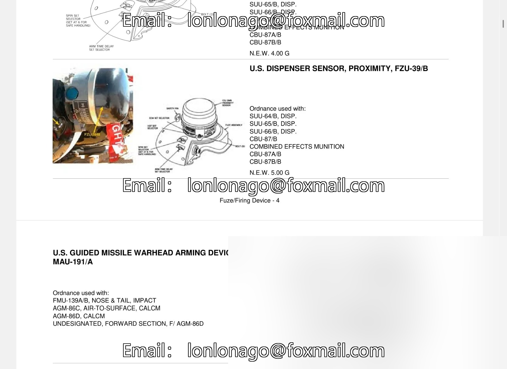
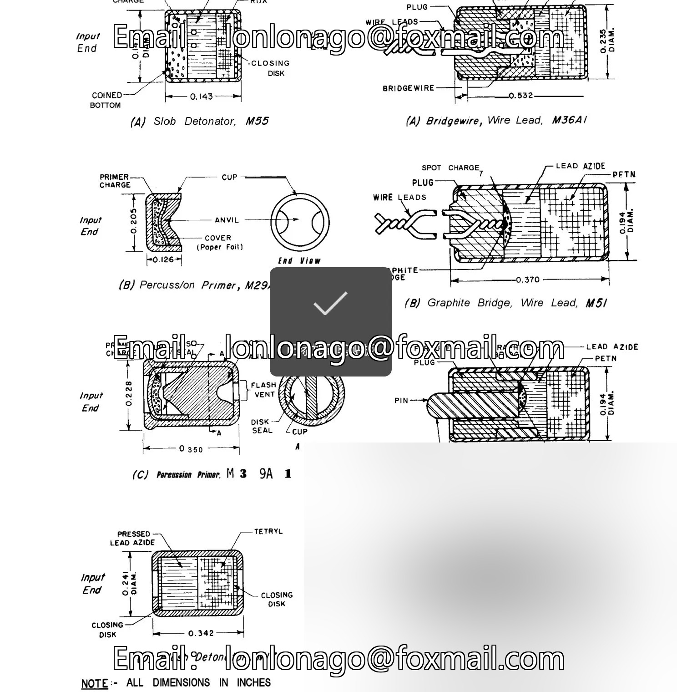
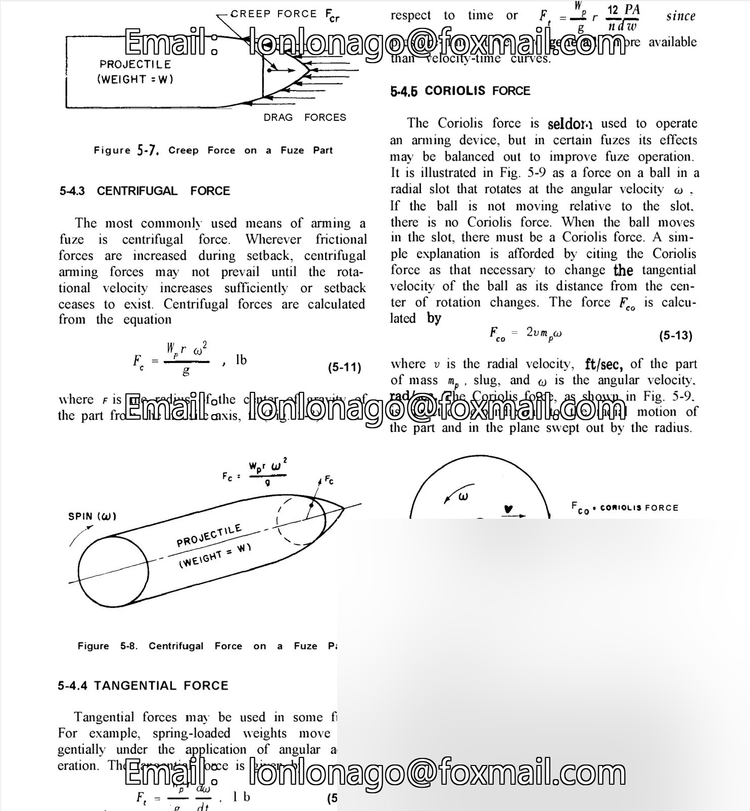
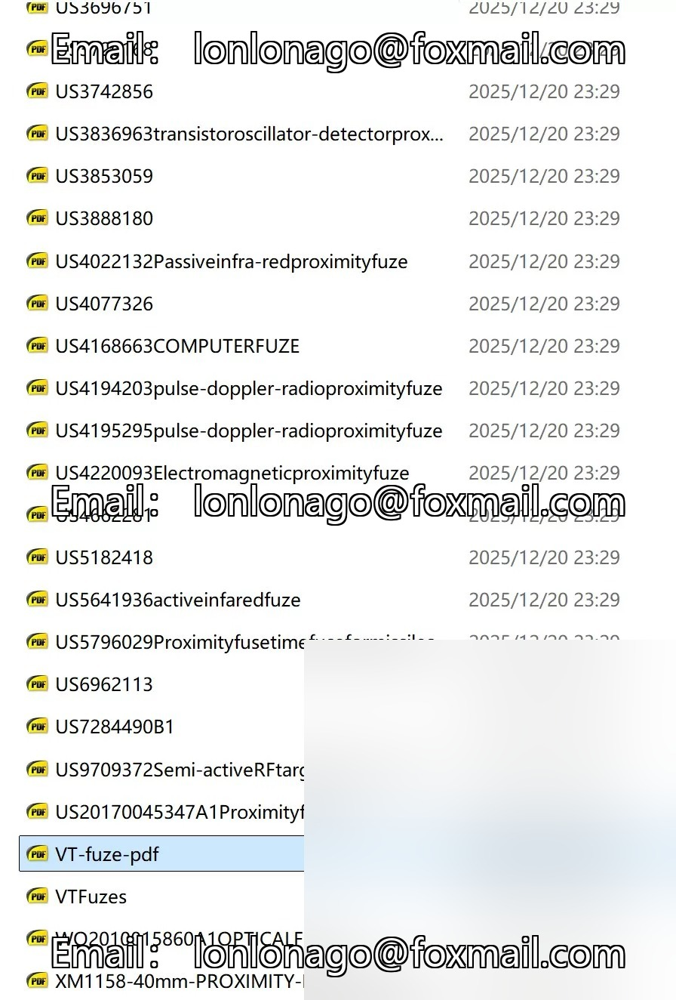
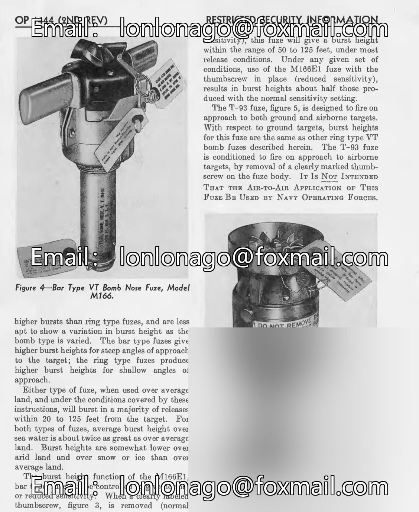

# Continuous rod-type combat head long-range detonation engineering data set

## Body

Continuous rod-type combat head long-range detonation engineering data set
Approximately 67 volumes.
CONTINUOUS ROD (Continuous Rod):​ translate as “continuous rod”, which is a type of explosive, its fragments are pre-made into a continuous structure for effectively cutting targets (such as aircraft wing surfaces).
Main characteristics and content composition:

Rich material types:

American military technical manual: As shown in Figure 7, the core document is the official "Engineering Design Manual: Ammunition Series - Fuse" published by the U.S. Army Materiel Command in 1969. It is an authoritative guide for fuse design.

U.S. patent document: containing multiple U.S. patents (such as US3,853,059, etc.), it in detail explains the invention details, structural diagrams and rights claims of specific fuses or combat parts (such as configurable detonation fragments combat parts).

Standard technical standards and reports: e.g. other parts of the AMCP 706-210 series, OP series (naval ordnance publications) reports, etc., cover design materials from basic theory to specific models.

Intellectual property documents: include patent documents related to ignition related technologies from numerous US and other countries/regions (US, WO, etc.), showcasing the technological development trajectories.

Wikipedia entry and technical report: includes explanations of basic concepts and specialized technical reports.

Core technical theme:

Fuzes (Fuzes): The materials comprehensively cover various fuses, including proximity fuses (Proximity Fuze/VT Fuze), photoelectric fuses (Photoelectric Fuze), laser fuses (Laser Fuze), radio fuses (Radio Fuze), mechanical/press fuses, etc. The content covers design principles, circuits, test devices, and applications (such as bombs, missiles, landmines).

Warhead (Attack part): The focus involves continuous rod-style warheads and configurable fragmentation warheads, studying the effects of their structure and detonation methods (front, rear, and both ends simultaneously) on fragmentation spray direction, aiming to optimize damage effects.

Application and value:

Engineering research: To provide fundamental theories, design examples, and patent technical references for the design, analysis, and improvement of munitions, missiles, combat modules, and fuses.

Technical analysis: Can be used to understand the working principles and historical models of specific types of fuses or combat components (such as "toxic stake" missile fuses, anti-tank mine fuses).

Education and research: is high-quality teaching and reference materials in relevant fields such as military engineering, ammunition engineering, and weapon systems.

Technical traceability: Through patent documents, the development history and key invention points of relevant technologies (such as near-fuse ignition techniques) can be traced.

The collection covers engineering materials for continuous rod warheads with long-range detonation, including design manuals, patents, technical reports and intellectual property documents, plus specific detonation devices and supporting files.

<!-- AI_ENRICHED -->

## Images

## Payment

Here is a pay link on Stripe ( https://buy.stripe.com/3cs8yP7sY87d0vu9AB ). Please contact me lonlonago@foxmail.com after funding $89, and I will send you a complete data files , thank you!

